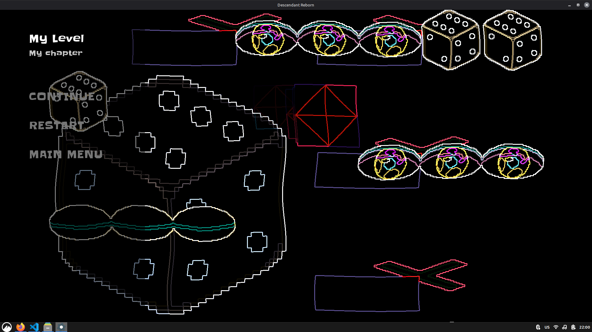

# AA3
AA3 story game based on my story Abyss Ascendant. Semi-sequel to Astral Surge. Currently WIP. While I'm still working on it, here's a funky shader screenshot:



## Building
This game depends on C++17, [Raylib](https://www.raylib.com/) and [SRU-Lib](https://github.com/Acerx-AMJ/SRU-Library). SRU-Lib is fetched automatically by CMake and that is the preferred way of building.
```bash
cmake -B build
cmake --build build
```
After, the executable will be located in `build/aa3`. Simply run it after building. Assets and data folders must be in the same folder as the game is ran in.

## Credits
This project, including all assets except for fonts and shaders, was made by Daniel Vishnevsky and is licensed under MIT License.
